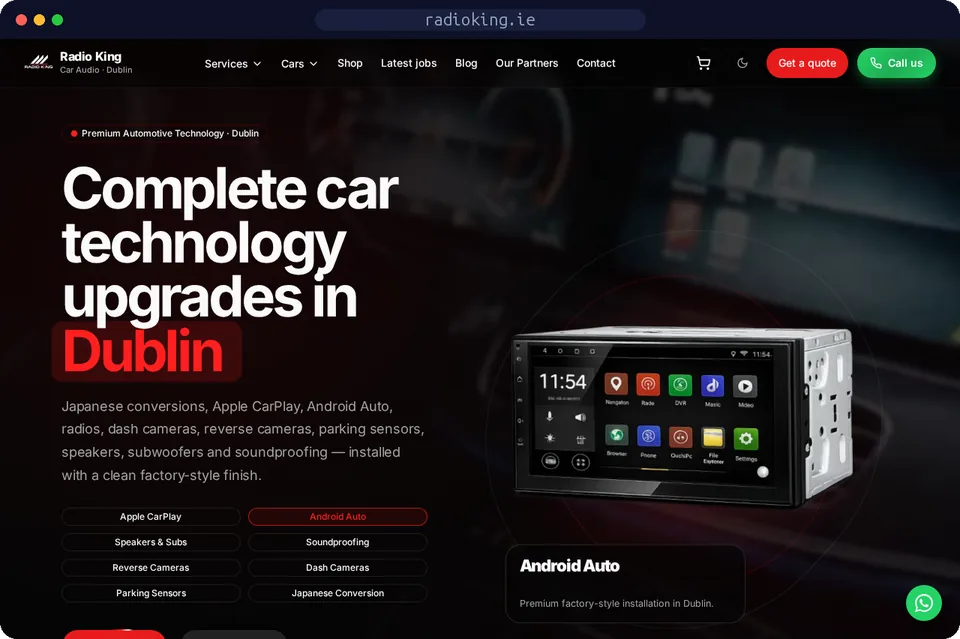
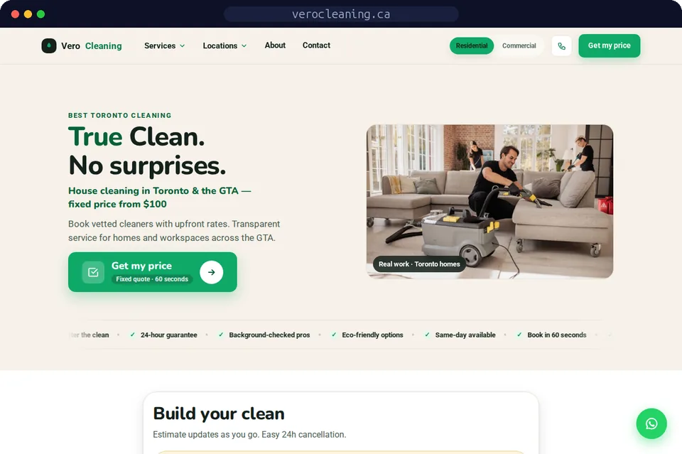
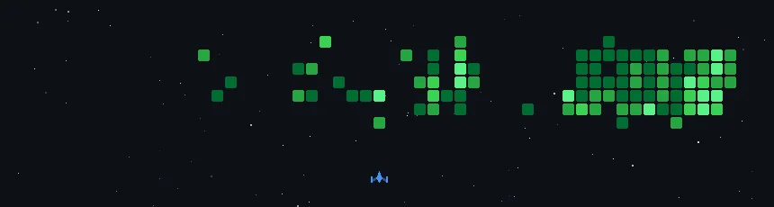

<!--
  Profile README for @hvidom.
  Artwork  → scripts/art.mjs   (bun scripts/art.mjs)
  Stats    → scripts/stats.mjs (daily, .github/workflows/profile.yml)
  Game     → czl9707/gh-space-shooter (daily, same workflow)
  Badges   → assets/badges/ + the "Badges & achievements" table below
-->

  

  
  
  
  
  

## 🛰️ Right now

- 🏭 **Building Content Factory**: one TypeScript platform that runs a car-electronics business in Dublin. It covers the CRM, an omnichannel inbox, the website CMS, the warehouse, payments and an AI agent.
- 🌐 **Shipping websites** on Astro and Cloudflare Workers that bring in real leads: [radioking.ie](https://radioking.ie) and [verocleaning.ca](https://verocleaning.ca).
- 🎓 **Going back to basics** in a Software Development course: a [Python Tetris](https://github.com/hvidom/TetrisGame) and [a C# game ported to TypeScript](https://github.com/hvidom/testGame).
- 🧠 **Into** open source, entrepreneurship and the psychology of sales. I spent years coaching salespeople, so now I build the tools I wish they'd had.
- ⚡ **Fun fact:** my AI agent *Merlin* answers customers at night so the sales team can sleep.

## 🚀 Featured work

<table>
  <tr>
    <td width="50%" valign="top">
      
      <h3><a href="https://radioking.ie">radioking.ie</a></h3>
      Website and shop for a car-electronics installer in Dublin. It has a landing page per search intent, about 175 products with Stripe Checkout and server-side order reconciliation, and it took over from WordPress without breaking a single URL.
        
      <code>Astro</code> <code>React</code> <code>Hono</code> <code>Stripe</code> <code>Cloudflare&nbsp;Workers</code>
    </td>
    <td width="50%" valign="top">
      
      <h3><a href="https://verocleaning.ca">verocleaning.ca</a></h3>
      Fixed-price house cleaning in Toronto and the GTA. Visitors get an instant quote builder, the content is edited in Pages CMS, and a DataForSEO keyword pipeline decides which pages get built.
        
      <code>Astro</code> <code>Hono</code> <code>Drizzle</code> <code>shadcn/ui</code> <code>Cloudflare</code>
    </td>
  </tr>
</table>

## 🧰 Tech stack

## 📡 GitHub telemetry

## 👾 Space shooter

  

Each green square is a day I pushed code, and the ship clears them one by one. <a href="https://github.com/czl9707/gh-space-shooter">gh-space-shooter</a> regenerates it every night.

## 🏆 Badges & achievements

<!--
  🏅 New badge? Put the image in assets/badges/ (PNG/SVG, square-ish, ~600 px)
  and copy one of the <td> cells below. Three cells per row; start a new <tr> for the fourth.
-->
<table>
  <tr>
    <td align="center" width="33%">
      
       <b>daily.dev Top reader</b>
       React · September 2026
    </td>
    <td align="center" width="33%">
      
       <b>daily.dev DevCard</b>
       live reading stats
    </td>
    <td align="center" width="33%">
      
       <b>Hacktoberfest 2023</b>
       Participant · via Holopin
    </td>
  </tr>
</table>

<b>📜 Career timeline</b> · 15+ years across code, infrastructure and sales

 

| When | Role | What it looked like |
| :-- | :-- | :-- |
| **2026** | Builder of Content Factory | Everything below at once: a CRM, an omnichannel inbox, a CMS, a warehouse and AI agents in one TypeScript monorepo, running a real business |
| **2020 → now** | Sales Director & Technology Architect | Sales engineering and tech integrations: CRM workflows (HubSpot, Salesforce) wired into backend data. Coached 30+ sales agents |
| **2015 → 2020** | Senior Full-Stack Developer | UI and backend architecture for digital products: React, Vue and Next.js on top of Node APIs and PostgreSQL, with strict CI/CD |
| **2011 → 2015** | Infrastructure Engineer & Linux Administrator | Hardened server clusters, kernel-level firewalls, automated backups, Docker, load balancers and Cloudflare DNS protection |

<b>🗄️ Legacy account</b> · <a href="https://github.com/Frikadellios">@Frikadellios</a>, 2019 → 2025, 770+ repositories of experiments

 

That account holds years of experiments. A few highlights:

- [**belmondo**](https://github.com/Frikadellios/belmondo): Turborepo with shadcn/ui on OKLCH palettes, an Astro frontend and a Vite backend on Cloudflare
- [**astro-tw-4-bun**](https://github.com/Frikadellios/astro-tw-4-bun): the Tailwind CSS 4 alpha with Bun and an Astro PWA, in production before Tailwind 4 was stable
- [**Strapi-TS**](https://github.com/Frikadellios/Strapi-TS): a headless CMS for an Astro site across Koyeb, Neon, Cloudflare and Vercel
- [**salo-ai**](https://github.com/Frikadellios/salo-ai): my entry for the Cloudflare AI Challenge, April 2024
- [**shadowbun**](https://github.com/Frikadellios/shadowbun): an Astro starter with Tailwind 4, shadcn/ui and Aceternity UI
- [**vite-darkness**](https://github.com/Frikadellios/vite-darkness): Vite 5 with Tailwind 4, Biome and Vue Devtools, deployed with a single `bun run deploy`

  

 

  

Hand-coded SVG artwork (<a href="scripts/art.mjs">scripts/art.mjs</a>). The stats and the game refresh every night via <a href=".github/workflows/profile.yml">GitHub Actions</a>.

